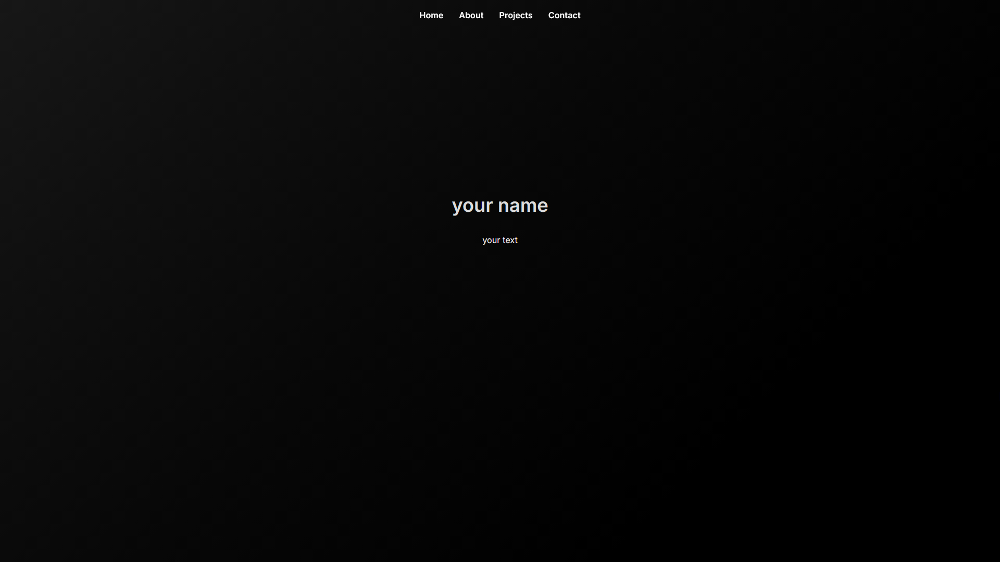
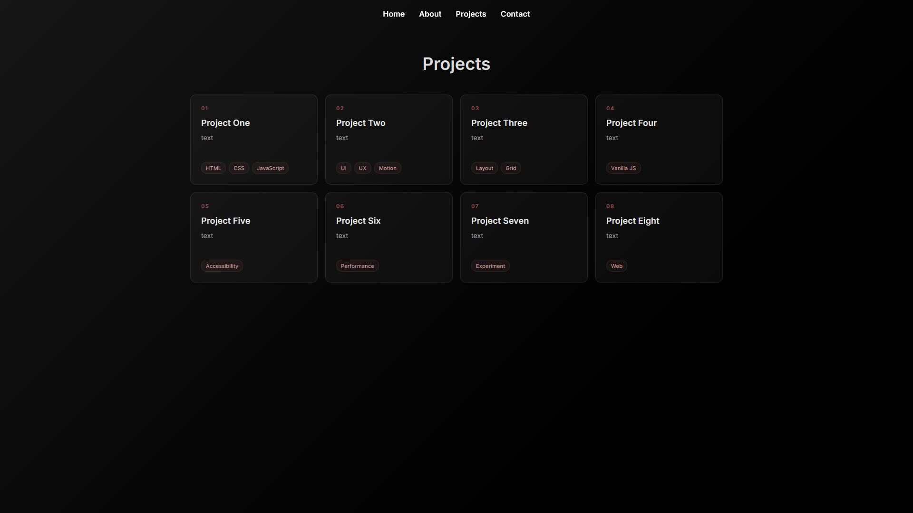
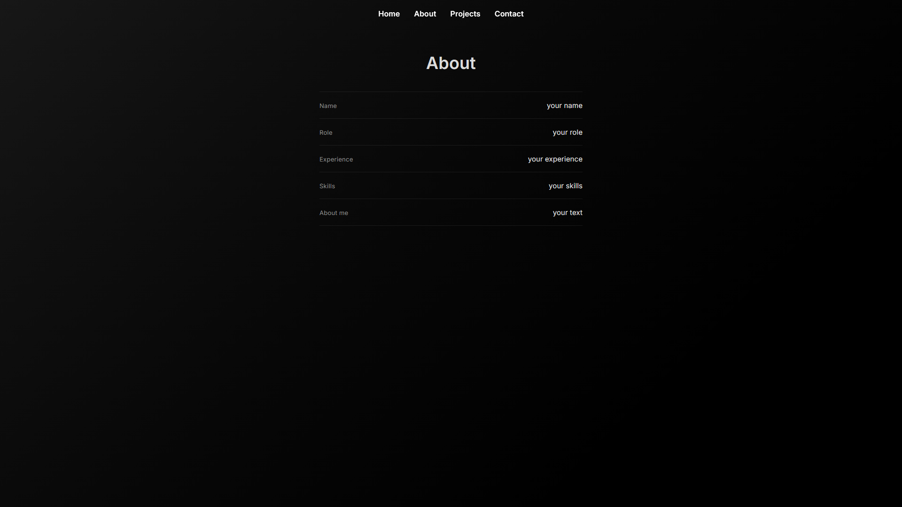
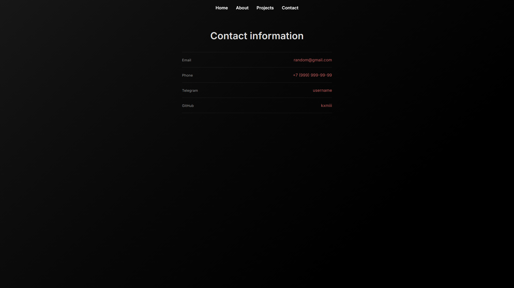

# Portfolio

A small personal portfolio built with plain HTML, CSS, and JavaScript. No frameworks, no build step, no dependencies.

**Live:** [kxmiii.github.io/web-bio](https://kxmiii.github.io/web-bio/)

## Screenshots

| Home | Projects |
| --- | --- |
|  |  |
|  |  |

## What's inside

- Four pages: home, about, projects, and contacts.
- Smooth page transitions without full reloads. Pages are preloaded on hover, and the scroll position is remembered when you go back.
- Responsive project grid: four columns on desktop, two on tablets, one on phones.
- Dark theme with a soft gradient and a muted red accent.
- Working contact links: email, phone, Telegram, and GitHub.
- Respects reduced motion and stays readable without JavaScript.

## Structure

```text
.
├── assets/
│   └── favicon.ico
├── css/
│   └── styles.css        # all styles and responsive rules
├── js/
│   ├── main.js           # navigation, prefetch, history, scroll
│   ├── nav.js            # active menu link and link handling
│   └── pageLoader.js     # loading and caching pages
├── about.html
├── contacts.html
├── index.html
├── projects.html
└── README.md
```

## Run locally

The site is static, but it needs to be served over HTTP — opening `index.html` directly from disk will not load the scripts.

```bash
# Python
python -m http.server 8000

# or Node
npx serve .
```

Then open <http://localhost:8000/>.

## Make it yours

1. Replace the placeholder text on the home and About pages.
2. Update the contact details in `contacts.html` and keep the link format (`mailto:`, `tel:`, Telegram, GitHub).
3. Add your projects to `projects.html` — each card has a number, a title, a short description, and a few tags.
4. If you add a new page, give it a `#content` block and a link in the navbar.
5. If the site moves to another domain, update the canonical URLs in the four HTML files.

## Deployment

The site is hosted on **GitHub Pages** straight from the `main` branch. There is no build step: push the files and they go live.

## About the project

This was my first experience creating a website from a blank page to a universal website. A simple idea, a little work, and this beautiful minimalistic portfolio turned out to be recreated, created with little experience, but quite an interest in web development.
